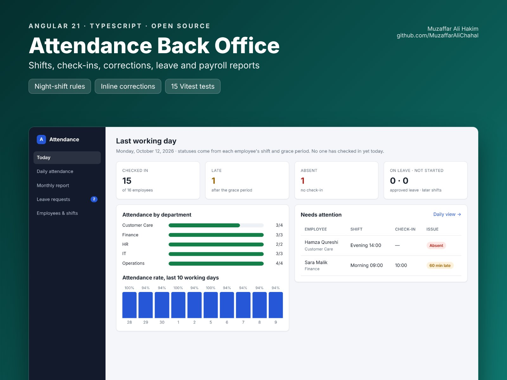

# Attendance Back Office (Angular)


   

An Angular 21 HR back office for employee attendance: daily check-ins from biometric devices or a mobile app, shift rules, manual corrections, leave approval and a payroll-ready report.

**Live demo:** https://muzaffaralichahal.github.io/angular-attendance-backoffice/ (30 days of generated attendance for 16 employees)



## Features

- **Today:** checked in, late, absent and on leave; attendance by department; a 10-day attendance trend; who needs attention
- **Daily attendance:** any day in the last month, filtered by department and status, with worked time, lateness, overtime and the punch source
- **Manual corrections:** fix a check-in or check-out inline. It's saved as a MANUAL punch with who made it, and every view and report recalculates immediately.
- **Report:** days present, late, half days, absences, leave, hours worked and overtime per employee, sortable, with a CSV export for payroll
- **Leave requests:** approve or reject; approved days show as leave instead of absences
- **Employees & shifts:** morning, evening and night shifts with grace periods

## Attendance rules

All in [`rules.ts`](src/app/core/rules.ts), as pure functions with unit tests:

- **Late** when the check-in is after shift start plus the grace period
- **Half day** when less than half the shift is worked
- **Overtime** is time after the shift's end
- **Night shifts** (e.g. 22:00–06:00) count toward the day they start; a check-in at 00:30 is 150 minutes late, not 21 hours early
- **Absent** on a working day without a check-in, **Not started** if today's shift hasn't begun yet, **On leave** for approved leave

## How it's built

| Concern | Approach |
| --- | --- |
| State | One signal store (`AttendanceStore`); daily records and reports are `computed()` from raw punches + shifts + leave |
| API layer | Abstract `AttendanceApi` with an HTTP implementation for [`docs/api.md`](docs/api.md) and an in-memory demo |
| Forms | Template-driven inline editing for corrections, typed inputs for filters |
| Tests | 15 Vitest tests: every rule including overnight shifts, and the store (correction → recalculated status) |

## Run it

```bash
npm install
npm start      # demo mode at http://localhost:4200
npm test
```

To use a real backend, implement [`docs/api.md`](docs/api.md) (for example a Spring Boot service fed by ZKTeco or other biometric devices) and run `npx ng serve --configuration live`, which proxies `/api` to `http://localhost:8080`.

## Deployment

GitHub Actions runs the tests, builds with the right `--base-href`, and publishes the demo to GitHub Pages on every push to `main`.

## License

MIT
